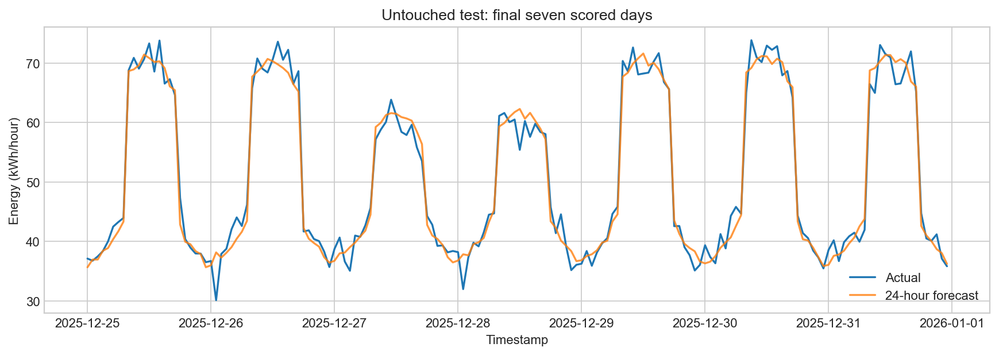
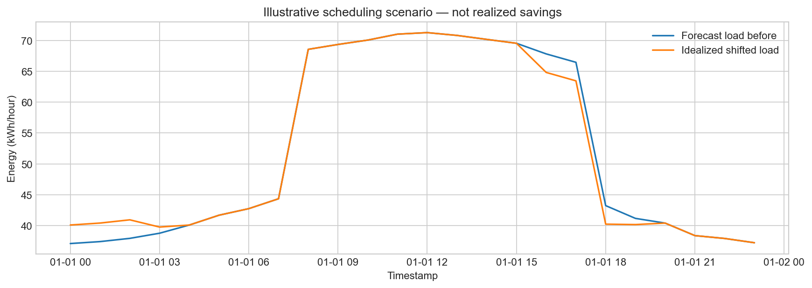

# AI-Powered Energy Consumption Forecasting System — Complete Practical Guide

This guide is written for a student building genuine GitHub proof of work. It contains A-M instructions, executable source files, a complete README, and a proof plan. Source-code sections are included below the guide; copy each block into the named file or simply use the supplied project folder.

## A. Project explanation

### In simple language
Energy forecasting means predicting how much electricity a building or facility will use in the future from patterns in its past usage. If consumption rises during working hours and falls at night, a model can learn that pattern and estimate tomorrow's hourly demand. The forecast helps an operator prepare before demand arrives.

The problem is not merely drawing a smooth graph: operators must decide when to purchase electricity, run flexible equipment, charge batteries and investigate unusual demand. Bad forecasts may contribute to over-procurement, expensive peak-hour consumption or under-preparation. Forecasts support decisions; they cannot guarantee savings or replace engineering constraints.

### In technical language
This project is a supervised multi-output time-series regression task. For daily forecast origin t (the last completed hour labeled 23:00), construct x_t from observed energy through t and known next-day calendar features. Predict the vector [y_(t+1), ..., y_(t+24)]. Train only on older eligible days, select algorithms on a later validation block and evaluate once on a still-later held-out block.

### Why industries care
| Industry | Planning problem | Forecast-supported decision | Important caveat |
|---|---|---|---|
| Smart cities | Combined demand from buildings, lighting, charging | Plan infrastructure loading and flexible charging | Aggregate city data is not implemented here |
| Electricity boards | Demand uncertainty | Procurement, reserves and balancing | Reliability and regulation require broader systems |
| Manufacturing | Expensive peak-hour process loads | Shift verified flexible operations | Safety and throughput constraints come first |
| Data centers | Cooling and compute demand | Schedule deferrable batch jobs, assess cooling needs | Do not violate service-level agreements |
| Renewable energy | Variable supply and demand | Plan storage/grid purchases using separate generation forecast | Load forecasting is not solar/wind generation forecasting |

### Full workflow
1. Collect historical meter energy values and timestamp/unit metadata.
2. Validate timestamps, duplicates, units, negative/infinite values and gaps.
3. Clean causally, retaining flags identifying genuinely observed values.
4. Build lag, rolling and calendar features available at forecast time.
5. Build chronological train/validation/test partitions of daily origins.
6. Train simple models and seasonal-naive baselines.
7. Select using validation RMSE; freeze that decision before test evaluation.
8. Evaluate hourly RMSE/MAE/R2 and errors by forecast horizon.
9. Refit the selected algorithm on all available labels AFTER test scoring.
10. Forecast future hourly demand; generate graphs and scenario reports.

## B. Tech stack options

| Option | Tools | Models | Difficulty | GPU | Expected deliverable |
|---|---|---|---|---|---|
| A: easiest, selected | Python, NumPy, Pandas, Matplotlib, scikit-learn, joblib, Git | Seasonal-naive, Linear Regression/Ridge, Random Forest | Beginner-friendly | No | CLI, CSV forecasts, metrics, graphs, clear README |
| B: intermediate | Option A + statsmodels, optional gradient boosting, Jupyter and dashboard | SARIMA/SARIMAX, HistGradientBoosting/XGBoost, rolling backtests | Intermediate; seasonality and exogenous-data discipline needed | No for these CPU baselines | Backtesting reports, parameter comparisons, optional dashboard |
| C: advanced | PyTorch or TensorFlow, experiment tracking, inference API | LSTM/GRU/temporal models plus strong classical baselines | Advanced | Not mandatory for a small model; helpful for larger experiments | Neural-model experiments, monitoring and reproducible inference |

LSTM is not automatically better and is unnecessary for a first project. ARIMA models temporal dependence; SARIMA adds seasonality; SARIMAX can include known exogenous inputs. Random Forest captures nonlinear interactions but extrapolates poorly outside its training distribution. Linear/Ridge regression is easy to inspect; Ridge reduces sensitivity to correlated lag features using L2 regularization.

## C. Selected approach

Choose Option A. It is inexpensive, executable on CPU, explainable in interviews and substantial enough for proof of work. Start with a deterministic virtual facility to make the pipeline work offline; then use the public UCI measured-data experiment to demonstrate that synthetic and real-data performance differ.

Scope: one series, hourly energy, 24-hour next-day forecast, 168-hour lookback. Models: previous day, previous week, standardized Ridge and Random Forest. Use two distinct evidence tracks:
- Synthetic track: exercise the full workflow and virtual cost scenario.
- Measured UCI track: evaluate forecasting on actual household recordings; do not claim factory-level generalization.

## D. Architecture and implementation phases

```text
Hourly CSV / synthetic source / UCI minute meter recordings
                              |
              src/data.py: load, convert units, clean, quality report
                              |
              src/features.py: past-only history + next-day calendar
                              |
              Eligible origin rows + 24-hour target vectors
                              |
                  Chronological 60 / 20 / 20 partition
                              |
              src/model.py: training + baseline comparison
                              |
              Validation selection -> frozen held-out evaluation
                              |
              Evaluation artifact + future-use all-data refit
                              |
                    Next-day forecast CSV
                              |
           src/plots.py: graphs; src/simulation.py: hypothetical bill scenario
                              |
                    README + reports + GitHub proof
```

### Phase 1 — setup
- Do: install Python 3.11-3.13, Git and VS Code; extract/create the project; create `.venv`; install dependencies.
- Why: isolate packages and make experiments repeatable.
- Output: source files, environment, Git repository.
- Common mistakes: using the wrong Python interpreter or committing `.venv`.
- Verify: `python --version`; `python -c "import pandas, sklearn; print('OK')"`; inspect `git status`.

### Phase 2 — dataset loading
- Do: run the synthetic generator; optionally download the official UCI ZIP.
- Why: develop without needing corporate credentials and then test measured data.
- Output: `data/raw/synthetic_energy.csv`; optional UCI TXT; `outputs/dataset_preview.csv`.
- Common mistakes: describing synthetic readings as real; treating kW as kWh; mixing multiple facilities without an ID.
- Verify: columns are `timestamp,energy_kwh`; row order/frequency and value units are understood.

### Phase 3 — cleaning
- Do: parse/sort timestamps, average duplicate readings, reindex hourly, reject invalid values, forward fill at most two hours and retain observed flags.
- Why: sensor data is imperfect, but repairs must not access future measurements.
- Output: cleaned CSV and `outputs/data_quality.json`.
- Common mistakes: backward fill, full-data mean imputation, interpolation across split boundaries, treating imputed labels as genuine.
- Verify: quality counts; continuous hourly index; observed mask; no negative valid energy; long gaps remain unfilled.

### Phase 4 — feature engineering
- Do: build historical lags and rolling summaries through each origin; add next-day calendar values.
- Why: convert historical patterns into model inputs.
- Output: features with one row per forecast day and target matrix with 24 columns.
- Common mistakes: rolling windows that include target hours; actual future weather as an input; random splitting; missing-data labels leaking into scores.
- Verify: `outputs/feature_preview.csv`; test that changing all future readings leaves origin features unchanged.

### Phase 5 — model building
- Do: fit Ridge and Random Forest on the chronological training block; generate previous-day/week baselines.
- Why: establish whether added complexity improves a simple operational benchmark.
- Output: validation comparison and model bundles.
- Common mistakes: no baseline; scaling outside the training pipeline; treating many hourly targets as independent training days.
- Verify: Ridge's scaler was fit only on train; all candidates share target days; validation is later than train.

### Phase 6 — evaluation
- Do: select lowest-validation-RMSE algorithm, then evaluate locked test; compute overall and horizon metrics.
- Why: estimate future behavior without selecting on final-test results.
- Output: `metrics.json`, validation/test tables, horizon metrics and actual/predicted records.
- Common mistakes: reporting training R2 as test quality; converting R2 into percentage accuracy; changing the winner after inspecting test scores.
- Verify: split boundary assertions, test dates, eligible/excluded-day counts, and baseline improvement sign.

### Phase 7 — forecasting
- Do: after locked test evaluation, refit selected algorithm on all eligible labels; create next-day forecasts from last 168 usable hours.
- Why: use the most recent measured history for future predictions.
- Output: `production_model.joblib` and `next_day_forecast.csv`.
- Common mistakes: forecasting from a partial day, recursively using unavailable actual target hours, evaluating the production refit on its own training period.
- Verify: exactly 24 future timestamps; first timestamp is one hour after last observed origin; no negative prediction.

### Phase 8 — visualization
- Do: save history, actual-versus-predicted, scatter, residual, validation comparison, future forecast and scenario charts.
- Why: show both model usefulness and failure modes clearly.
- Output: seven labeled PNGs.
- Common mistakes: unlabeled axes, future forecasts depicted as actual observations, marketing claims unsupported by graphs.
- Verify: image files open, units/titles/legends are correct, residuals are actual minus predicted.

### Phase 9 — GitHub publishing
- Do: inspect `.gitignore`; create an empty public repository; commit code/cards/reports/images; push; check README links.
- Why: make the project reproducible and reviewable by recruiters.
- Output: public repository with meaningful history.
- Common mistakes: uploading raw 127 MB files, credentials, `.venv`, model binaries or broken image paths; pretending a seven-day plan is completed history.
- Verify: clone on a clean machine; recreate environment; run tests and pipeline; confirm no generated-only dependency is required.

### Phase 10 — final output
- Do: record a short demo; document results and limitations; create a release; pin the repository; write an honest resume bullet.
- Why: convert working code into persuasive, auditable proof.
- Output: code + measured results + synthetic simulation + proof assets + concise explanation.
- Common mistakes: saying 'production deployed' or 'saved a company money' when neither happened.
- Verify: every portfolio claim points to code, report, test, plot or actual recording.

## E. Folder structure and responsibilities

```text
AI-Energy-Forecasting/
|-- data/
|   |-- raw/                    # Local datasets; not committed
|   `-- processed/              # Causal hourly table; not committed
|-- notebooks/                 # Optional exploration; no required notebook dependency
|-- src/
|   |-- __init__.py
|   |-- data.py                 # Synthetic source, UCI adapter and cleaning
|   |-- features.py             # Historical features, splits and naive forecasts
|   |-- model.py                # Training, metrics, model selection, artifacts
|   |-- plots.py                # Static proof graphs
|   `-- simulation.py           # Illustrative time-of-use scenario
|-- models/                     # Train locally; binaries ignored in Git
|-- outputs/
|   `-- public_uci/             # Isolated real-household evidence
|-- images/                     # Compact chart evidence kept in Git
|-- docs/
|   |-- dataset_card.md
|   |-- model_card.md
|   `-- IMPLEMENTATION_GUIDE.md
|-- tests/
|   `-- test_pipeline.py
|-- README.md
|-- requirements.txt
|-- .gitignore
|-- main.py
`-- public_experiment.py        # Separate measured-data run
```

Empty `data/`, `models/` and `notebooks/` directories have `.gitkeep` placeholders so Git retains the intended layout. The supplied project intentionally uses scripts, not notebooks, as the reproducible source of truth.

## F. Installation

Recommended Python: 3.11, 3.12 or 3.13. Tested here: 3.13.14. VS Code optional. No GPU is required. Small synthetic runs need modest RAM; loading the full UCI minute file needs more memory, so an 8 GB computer is comfortable. Actual runtime depends on CPU and installed library builds.

### Windows PowerShell
```powershell
cd path\to\AI-Energy-Forecasting
py -3.11 -m venv .venv
.\.venv\Scripts\Activate.ps1
python -m pip install --upgrade pip
python -m pip install -r requirements.txt
python -m unittest discover -s tests -v
python main.py --mode all
```
Use your installed 3.12/3.13 instead of 3.11 if applicable. If activation is blocked:
```powershell
.\.venv\Scripts\python.exe -m pip install -r requirements.txt
.\.venv\Scripts\python.exe main.py --mode all
```
Windows Command Prompt activation: `.venv\Scripts\activate.bat`.

### macOS / Linux
```bash
cd /path/to/AI-Energy-Forecasting
python3.11 -m venv .venv
source .venv/bin/activate
python -m pip install --upgrade pip
python -m pip install -r requirements.txt
python -m unittest discover -s tests -v
python main.py --mode all
```
Use `python3.12` or `python3.13` if that is your installed version. On Debian/Ubuntu, missing venv support may require the package matching your Python version, installed using your OS package manager.

Dependencies and reasons: Pandas for timestamps/CSV; NumPy for math and generation; scikit-learn for models/metrics/scaling; Matplotlib for portable graphs; joblib for local trusted model persistence. Seaborn is not required: a bundled Matplotlib style is used instead.

## G. Full working code

The complete code and configuration are reproduced in the 'Copy-paste source files' section below. Each block includes its filename and responsibility. Create the folder tree, copy all blocks and run `python main.py --mode all`. No other code or API key is required. The ZIP already contains these exact files.

### Important implementation choices
- Direct multi-output forecasts: all next-day hours are predicted together.
- Current-origin consumption is allowed: it is already observed when inference runs.
- Calendar features are known beforehand; weather is deliberately excluded.
- Imputed hours may support historical features, but never become training/evaluation targets.
- A baseline is allowed to win validation. Complex models are not guaranteed to beat it.
- `evaluation_model.joblib` is train-only; `production_model.joblib` is all-label refit.
- Model files are regenerated, not required in the distributed source archive.

## H. Virtual simulation, step by step

1. Treat synthetic hourly readings as a virtual meter for a small facility. Label them SYNTHETIC.
2. Inject known sensor imperfections and show cleaning decisions in the quality report.
3. Pretend the latest complete day's reading has just arrived. All future load is unknown to the model.
4. Predict the next day's 24 hourly values using available history and calendar values.
5. Add an explicitly illustrative tariff: $0.25/kWh from 16:00-21:00 inclusive; $0.10/kWh otherwise.
6. Compute the forecast energy bill: sum(hourly forecast energy * hourly tariff).
7. Assume 10 kWh is genuinely deferrable; shift at most 3 kWh per hour out of peak hours and into non-peak hours.
8. Assert before/after total energy is equal and hourly values remain nonnegative.
9. Recompute the illustrative bill and save both schedules and scenario assumptions.
10. Explain what a real engineer must verify: equipment flexibility, deadlines, receiving capacity, losses, demand charges, tariffs and operator approval.

The supplied run shows a $1.50 hypothetical bill difference ($169.98 -> $168.48), not realized savings. Energy is not reduced; only tariff timing changes. Do not annualize this into a proven business saving without real operational validation.

Capture `data_quality.json`, `next_day_forecast.csv`, `load_shift_scenario.csv`, `simulation_summary.json`, and the scheduling chart as proof.

## I. Execution and verified results

### Full workflow
```bash
python main.py --mode all
```
Train/evaluate only, then separately predict:
```bash
python main.py --mode train
python main.py --mode forecast
```
Custom hourly CSV:
```bash
python main.py --mode all --csv data/raw/my_hourly_energy.csv
```
Keep source type consistent: do not use the synthetic model for a household CSV. Each `all` run fits a fresh model on the specified data. `forecast` loads the current production artifact. Only deserialize locally produced or otherwise trusted joblib files.

### Optional public measured dataset
Download and extract the official UCI ZIP. Then:
```bash
python public_experiment.py --file data/raw/household_power_consumption.txt
```
This isolates outputs under `outputs/public_uci/` and preserves synthetic graphs/results. `main.py --mode train --uci-file ...` is also supported but intentionally replaces the root outputs. The original UCI recording ends at 21:00, so it is not suitable for this next-day forecast entry point without a documented trim to a complete day.

### Tests
```bash
python -m unittest discover -s tests -v
```
Eight tests check duplicates, sensor gaps, causality, chronological boundaries, label observation, deterministic generation, invalid readings, UCI energy units/partial hours and energy-conserving scheduling.

### Recorded metrics, not invented sample numbers
| Source | Chosen by validation | Train / validation / test days | Test RMSE | Test MAE | Test R2 | Reduction vs weekly naive RMSE |
|---|---|---|---:|---:|---:|---:|
| Synthetic | Ridge | 202 / 68 / 68 | 2.102356 | 1.671620 | 0.976793 | 25.708% |
| Measured UCI | Random Forest | 778 / 259 / 260 | 0.594464 | 0.430161 | 0.378376 | 27.869% |

RMSE and MAE units are kWh per hourly interval. R2 is a dimensionless score, not classification accuracy. The two datasets have different load scales: their absolute RMSE values cannot rank industry usefulness. Scores are conditional on complete eligible target days; report excluded-day counts as well.

Synthetic validation winner is Ridge even though Random Forest's final test RMSE is marginally smaller (2.100589). We do not switch the winner using test results.

### Example future rows from the supplied synthetic run
```text
timestamp,predicted_kwh,model
2026-01-01 00:00:00,37.111325,ridge
2026-01-01 01:00:00,37.427443,ridge
2026-01-01 02:00:00,37.950854,ridge
```
These are predictions for the day after the simulated history, not a claim of actual 2026 readings or a live current-day forecast.

### Graphs and meaning
1. Historical consumption: daily/weekly patterns.
2. Actual vs predicted: holdout tracking quality.
3. Prediction scatter: agreement and systematic bias.
4. Residual histogram: typical errors and tails.
5. Validation model comparison: why a model was selected.
6. Future next-day forecast: expected future profile, without actual truth.
7. Load shift simulation: hypothetical scheduling change.

## J. GitHub publishing strategy

Recommended repository name: `ai-energy-consumption-forecasting`.
Description: `Reproducible next-day energy forecasting with Python, chronological backtesting, measured public-data evaluation, and virtual load-shifting simulation.`
Topics: `python`, `machine-learning`, `time-series`, `energy-forecasting`, `scikit-learn`, `data-science`, `energy-analytics`, `simulation`.

1. Create an EMPTY public GitHub repository. Do not initialize it with a second README if your local folder already has one.
2. Use the Python project folder as the repository root; do not upload the enclosing platform's unrelated web template.
3. Review `.gitignore`, outputs and README for personal data/large files/secrets.
4. From inside `AI-Energy-Forecasting/`:
```bash
git init
git branch -M main
git config user.name "YOUR NAME"
git config user.email "YOUR GITHUB EMAIL OR NOREPLY EMAIL"
git add .
git status
git commit -m "Build reproducible energy forecasting baseline"
git remote add origin https://github.com/YOUR_USERNAME/ai-energy-consumption-forecasting.git
git push -u origin main
```
5. Authenticate using Git Credential Manager or `gh auth login` on YOUR OWN computer if installed; do not put tokens into files or README. GitHub account passwords are not supported for normal HTTPS Git authentication.
6. If `origin` already exists: `git remote -v`, then `git remote set-url origin <your-correct-url>` as needed. If the remote already contains commits, clone it first or integrate its history rather than force-pushing blindly.
7. Commit images/reports with code changes; exclude raw data, model binaries and virtual environments. `.gitignore` does not untrack files already committed; use `git rm --cached <path>` when needed and rotate any accidentally leaked secret.
8. Verify GitHub renders image paths and metrics, create release `v1.0.0`, pin the repository, and link a short demo.
9. Clone into a NEW folder and run tests/full workflow: this proves reproducibility better than screenshots alone.

### Interview explanation
'I forecast 24 hourly energy values at a daily origin using only historical measurements and known calendar inputs. I compared Ridge and Random Forest against daily and weekly seasonal baselines, selected on validation data and locked the final test. My virtual scenario demonstrates load timing, not measured corporate savings. Real household data had much lower R2 than the synthetic data, which is why I report both.'

### Honest resume bullet
'Built a reproducible Python next-day energy forecasting pipeline with chronological validation, seasonal-naive benchmarks and automated leakage/unit tests; evaluated on public UCI household data with test RMSE 0.594 kWh/hour and 27.9% lower RMSE than a weekly-naive baseline on eligible test days.'

Only use that bullet after reproducing and understanding the supplied measured experiment. Do not imply the project was your unaided original invention; be able to explain, modify and defend every component.

## K. README content

The full copy-paste README is reproduced below the source blocks and is already saved as `README.md`. Replace the repository placeholder with your actual GitHub URL after publishing. Preserve the distinction between completed features, potential industry applications, unimplemented features and simulation assumptions.

## L. Seven-day commit and learning plan

| Day | Task | Suggested real commit | Evidence |
|---|---|---|---|
| 1 | Set up environment, layout and dependencies | `chore: initialize project and Python environment` | Version checks, clean Git status, requirements |
| 2 | Read dataset docs; generate virtual meter; load UCI | `feat: add reproducible synthetic data and UCI adapter` | Dataset preview, source/license card |
| 3 | Implement cleaning and observation flags | `feat: add causal preprocessing and quality checks` | Quality report, gap/duplicate tests |
| 4 | Engineer historical features; add models/baselines | `feat: add direct next-day regression and seasonal baselines` | Feature preview, training/validation log |
| 5 | Lock chronological evaluation; analyze errors | `feat: add holdout metrics and horizon diagnostics` | Metrics tables, test predictions, baseline comparison |
| 6 | Generate graphs and scheduling scenario | `feat: add forecast visualization and virtual load shifting` | Seven PNGs, scenario CSV/JSON |
| 7 | Write docs, verify clean clone, publish demo/release | `docs: publish reproducible results and project guide` | README, clone verification, repository/demo screenshots |

If starting from this already complete starter, commit the starter honestly once, then make real learning/extension commits (extra dataset checks, extra diagnostics, cross-validation, improved constraints). Do not fabricate dates or split untouched borrowed code into a misleading development history. This is a plan for real work, not a guarantee that seven staged commits prove expertise.

## M. Proof checklist and demo assets

| Proof | Recommended filename | Store | What it establishes |
|---|---|---|---|
| Dataset preview | `08_dataset_preview.png` | images/ | Schema and units understood |
| Data cleaning report | `09_preprocessing_report.png` | images/ | Missing/duplicate handling documented |
| Training/validation terminal | `10_training_log.png` | images/ | Code executed and selection is visible |
| Forecast | `06_next_day_forecast.png` | images/ | Future profile generated |
| Actual vs predicted | `02_actual_vs_predicted.png` | images/ | Held-out comparison, not training fit |
| Error metrics terminal | `11_error_metrics.png` | images/ | Numerical metrics and baseline comparisons |
| GitHub repository | `12_github_repository.png` | images/ | Public code/docs/commit history exist |
| Automated tests | `13_test_results.png` | images/ | Basic correctness checks pass |
| Optional demo video | `energy_forecasting_demo.mp4` | Release/video host | End-to-end explanation and execution |

Only the seven graph PNGs are generated automatically. Terminal, GitHub and demo recordings must be captured from actual runs; they are not included as fabricated screenshots.

README embed example:
```markdown



```
Do not include a screenshot reference before the file exists. Use repository-relative paths, compact PNGs and legible text; blur personal paths/tokens if necessary. The underlying CSV/JSON and source code matter more than screenshots.

### Three-minute demo script
- 0:00-0:25: Explain the decision problem and dataset limitations.
- 0:25-0:55: Show folder structure, source modules and tests.
- 0:55-1:25: Run the synthetic CLI and open validation/test reports.
- 1:25-1:55: Show held-out plot and future forecast; explain they are different.
- 1:55-2:25: Show separate measured UCI results and discuss lower real-data R2.
- 2:25-2:50: Explain tariff assumptions and hypothetical $1.50 difference.
- 2:50-3:00: Show GitHub README and one sensible next improvement.

### Troubleshooting
- `ModuleNotFoundError`: use the activated environment; `python -m pip install -r requirements.txt`.
- No model in forecast mode: run `python main.py --mode train` first.
- History ends before/after 23:00: trim a copy to a completed final day or use training-only mode.
- Not enough eligible days: increase history and inspect gaps; do not invent missing labels to inflate coverage.
- Long missing final history: repair the source appropriately or wait for enough measured history; limited forward fill intentionally refuses long gaps.
- Model/source mismatch: train again on the source you intend to forecast.
- Broken chart links: verify exact capitalization and commit the images.
- Poor metrics: report honestly; add appropriate external variables and better backtesting, not test-driven cherry-picking.

---

# Copy-paste source files

The following blocks are the exact executable source. This section is populated from the delivered files, followed by the complete README.

## `requirements.txt`

Pinned core packages. Install with python -m pip install -r requirements.txt.

```text
# Python 3.11-3.13; end-to-end tested with Python 3.13.14.
numpy==2.3.5
pandas==2.2.3
matplotlib==3.10.9
scikit-learn==1.6.1
joblib==1.5.3

```

## `.gitignore`

Exclude raw downloads, environments, caches, secrets and reproducible model binaries.

```text
.venv/
venv/
__pycache__/
*.py[cod]
.pytest_cache/
.ipynb_checkpoints/
.env
.env.*
.dev.vars
.DS_Store
Thumbs.db
models/*.joblib
data/raw/*
!data/raw/.gitkeep
data/processed/*
!data/processed/.gitkeep
outputs/run.log
*.zip

```

## `src/__init__.py`

Mark src as a Python package.

```python
"""AI-Powered Energy Consumption Forecasting System."""

```

## `src/data.py`

Generate the virtual meter, load hourly/real minute data, convert units, and clean causally.

```python
"""Reproducible virtual facility and causal hourly data cleaning."""
from pathlib import Path
import numpy as np
import pandas as pd


def generate_data(path: Path, days: int = 365, seed: int = 42):
    """Hourly kWh; entirely synthetic, not corporate measurements."""
    if days < 90:
        raise ValueError('Use at least 90 synthetic days; 365 is recommended.')
    rng = np.random.default_rng(seed)
    t = pd.date_range('2025-01-01', periods=days * 24, freq='h')
    hour = t.hour.to_numpy()
    work = ((hour >= 8) & (hour < 18)).astype(float)
    weekday = (t.dayofweek < 5).astype(float)
    seasonal = 8 * np.cos(2 * np.pi * t.dayofyear.to_numpy() / 365)
    energy = (35 + 22 * work * (0.55 + 0.45 * weekday)
              + 6 * np.sin(2 * np.pi * (hour - 6) / 24)
              + seasonal + rng.normal(0, 2, len(t)))
    energy = np.maximum(energy, 0)
    # Deliberately introduce isolated sensor gaps and one duplicate.
    energy[rng.choice(np.arange(200, len(t) - 24), 20, replace=False)] = np.nan
    frame = pd.DataFrame({'timestamp': t, 'energy_kwh': energy})
    frame = pd.concat([frame, frame.iloc[[100]]], ignore_index=True)
    path.parent.mkdir(parents=True, exist_ok=True)
    frame.to_csv(path, index=False)
    return frame


def load_hourly(path: Path, uci: bool = False):
    if not path.exists():
        raise FileNotFoundError(f'Dataset not found: {path}')
    if not uci:
        return pd.read_csv(path)
    # Global_active_power is minute-averaged kW, NOT kWh.
    raw = pd.read_csv(path, sep=';', usecols=['Date', 'Time', 'Global_active_power'],
                      na_values=['?', ''], low_memory=False)
    t = pd.to_datetime(raw['Date'] + ' ' + raw['Time'],
                       format='%d/%m/%Y %H:%M:%S', errors='coerce')
    power = pd.to_numeric(raw['Global_active_power'], errors='coerce')
    s = pd.Series(power.to_numpy(), index=t).loc[lambda x: x.index.notna()]
    s = s.where(s >= 0).groupby(level=0).mean().sort_index()
    # Require ALL 60 minutes. A missing/partial hour remains a gap.
    energy = (s.resample('h').sum(min_count=60) / 60).rename('energy_kwh')
    return energy.rename_axis('timestamp').reset_index()


def clean_data(raw: pd.DataFrame):
    required = {'timestamp', 'energy_kwh'}
    if not required.issubset(raw.columns):
        raise ValueError('CSV must contain timestamp and energy_kwh columns.')
    df = raw[['timestamp', 'energy_kwh']].copy()
    df['timestamp'] = pd.to_datetime(df['timestamp'], errors='coerce')
    if isinstance(df['timestamp'].dtype, pd.DatetimeTZDtype):
        raise ValueError('Use consistent timezone-naive hourly timestamps for this demo.')
    invalid_time = int(df['timestamp'].isna().sum())
    df = df.dropna(subset=['timestamp'])
    if df.empty:
        raise ValueError('No valid timestamps.')
    if not (df['timestamp'] == df['timestamp'].dt.floor('h')).all():
        raise ValueError('Input must already be hourly. Use --uci-file for UCI minute data.')
    df['energy_kwh'] = pd.to_numeric(df['energy_kwh'], errors='coerce')
    invalid_values = (~np.isfinite(df['energy_kwh']) | (df['energy_kwh'] < 0))
    df.loc[invalid_values, 'energy_kwh'] = np.nan
    duplicate_rows = int(df.duplicated('timestamp').sum())
    # Duplicate readings are averaged, not summed: avoids double billing.
    series = df.groupby('timestamp')['energy_kwh'].mean().sort_index()
    series = series.reindex(pd.date_range(series.index.min(), series.index.max(), freq='h'))
    observed = series.notna()
    before = int(series.isna().sum())
    # Only past readings fill gaps. Never interpolate across train/test boundaries.
    filled = series.ffill(limit=2)
    result = pd.DataFrame({'energy_kwh': filled, 'observed': observed})
    result.index.name = 'timestamp'
    report = {'input_rows': len(raw), 'hourly_rows': len(result),
              'invalid_timestamps': invalid_time, 'duplicate_rows': duplicate_rows,
              'missing_before_fill': before, 'imputed_hours': int((~observed & filled.notna()).sum()),
              'remaining_missing': int(filled.isna().sum()),
              'first_timestamp': str(result.index.min()), 'last_timestamp': str(result.index.max())}
    return result, report

```

## `src/features.py`

Build past-only lag and rolling inputs, daily multi-output labels, chronological splits and seasonal baselines.

```python
"""Direct next-day features: all load features stop at forecast origin."""
import numpy as np
import pandas as pd

HORIZON = 24
LOOKBACK = 168


def origin_features(s: pd.Series, origin: pd.Timestamp):
    history = s.loc[origin - pd.Timedelta(hours=LOOKBACK - 1):origin]
    if len(history) != LOOKBACK or history.isna().any():
        raise ValueError(f'Need 168 consecutive usable hours ending at {origin}.')
    x = {f'lag_{lag}': float(history.iloc[-1 - lag]) for lag in (0, 1, 2, 23, 24, 47, 167)}
    for window in (24, 168):
        x[f'mean_{window}'] = float(history.iloc[-window:].mean())
        x[f'std_{window}'] = float(history.iloc[-window:].std())
    # The next day's calendar is known when making a forecast.
    tomorrow = origin + pd.Timedelta(hours=1)
    x['dow_sin'] = np.sin(2 * np.pi * tomorrow.dayofweek / 7)
    x['dow_cos'] = np.cos(2 * np.pi * tomorrow.dayofweek / 7)
    x['year_sin'] = np.sin(2 * np.pi * tomorrow.dayofyear / 365.25)
    x['year_cos'] = np.cos(2 * np.pi * tomorrow.dayofyear / 365.25)
    x['weekend'] = float(tomorrow.dayofweek >= 5)
    return x


def supervised_days(clean: pd.DataFrame):
    xs, ys, origins = [], [], []
    s = clean['energy_kwh']
    # Forecast at 23:00, after that hour is measured; predict 00:00..23:00.
    for origin in s.index[s.index.hour == 23]:
        target_times = pd.date_range(origin + pd.Timedelta(hours=1), periods=24, freq='h')
        target = s.reindex(target_times)
        observed = clean['observed'].reindex(target_times, fill_value=False)
        # Do not train or score on invented/imputed labels.
        if target.isna().any() or not observed.all():
            continue
        try:
            features = origin_features(s, origin)
        except ValueError:
            continue
        xs.append(features)
        ys.append(target.to_numpy())
        origins.append(origin)
    if len(xs) < 60:
        raise ValueError(f'Only {len(xs)} valid days; need >=60 (prefer >=180).')
    index = pd.DatetimeIndex(origins, name='origin')
    return pd.DataFrame(xs, index=index), np.asarray(ys)


def chronological_split(X, y):
    n = len(X)
    a, b = int(n * .6), int(n * .8)
    # Assert that training target windows finish before the next origin.
    assert X.index[a - 1] + pd.Timedelta(hours=24) <= X.index[a]
    assert X.index[b - 1] + pd.Timedelta(hours=24) <= X.index[b]
    return (X.iloc[:a], y[:a], X.iloc[a:b], y[a:b], X.iloc[b:], y[b:])


def seasonal_predictions(clean, origins, period):
    rows = []
    for origin in origins:
        future = pd.date_range(origin + pd.Timedelta(hours=1), periods=24, freq='h')
        previous = future - pd.Timedelta(hours=period)
        rows.append(clean['energy_kwh'].reindex(previous).to_numpy())
    return np.maximum(np.asarray(rows), 0)

```

## `src/model.py`

Fit regression models, select only on validation, score locked test, and refit a separate future-use model.

```python
"""Validation-only model selection, locked test, then production refit."""
import numpy as np
import pandas as pd
from sklearn.base import clone
from sklearn.ensemble import RandomForestRegressor
from sklearn.linear_model import Ridge
from sklearn.metrics import mean_absolute_error, mean_squared_error, r2_score
from sklearn.pipeline import make_pipeline
from sklearn.preprocessing import StandardScaler
from .features import chronological_split, seasonal_predictions


def metrics(actual, predicted):
    a, p = np.asarray(actual).ravel(), np.asarray(predicted).ravel()
    return {'rmse_kwh': float(np.sqrt(mean_squared_error(a, p))),
            'mae_kwh': float(mean_absolute_error(a, p)),
            'r2': float(r2_score(a, p))}


def predict_bundle(bundle, X, clean):
    if bundle['name'] in ('previous_day', 'previous_week'):
        period = 24 if bundle['name'] == 'previous_day' else 168
        return seasonal_predictions(clean, X.index, period)
    return np.maximum(bundle['estimator'].predict(X[bundle['features']]), 0)


def train_evaluate(X, y, clean):
    Xt, yt, Xv, yv, Xtest, ytest = chronological_split(X, y)
    candidates = {
        'previous_day': None,
        'previous_week': None,
        'ridge': make_pipeline(StandardScaler(), Ridge(alpha=10.0)),
        'random_forest': RandomForestRegressor(n_estimators=150, max_depth=10,
                                               min_samples_leaf=2, random_state=42, n_jobs=-1)
    }
    bundles, rows = {}, []
    for name, estimator in candidates.items():
        if estimator is not None:
            estimator.fit(Xt, yt)
        bundle = {'name': name, 'estimator': estimator, 'features': list(X.columns)}
        bundles[name] = bundle
        rows.append({'model': name, **metrics(yv, predict_bundle(bundle, Xv, clean))})
    # Test data has not been consulted at this point.
    validation = pd.DataFrame(rows).sort_values('rmse_kwh').reset_index(drop=True)
    winner = validation.iloc[0]['model']
    chosen = bundles[winner]
    predicted = predict_bundle(chosen, Xtest, clean)
    test_rows = [{'model': name, **metrics(ytest, predict_bundle(b, Xtest, clean))}
                 for name, b in bundles.items()]
    test = pd.DataFrame(test_rows)
    baseline_rmse = float(test.loc[test.model == 'previous_week', 'rmse_kwh'].iloc[0])
    chosen_rmse = metrics(ytest, predicted)['rmse_kwh']
    candidate_origins = clean.index[(clean.index.hour == 23)
                                    & (clean.index >= clean.index[0] + pd.Timedelta(hours=167))
                                    & (clean.index + pd.Timedelta(hours=24) <= clean.index[-1])]
    report = {'selected_model': winner, 'selection_rule': 'lowest validation RMSE',
              'candidate_forecast_days': len(candidate_origins),
              'eligible_forecast_days': len(X),
              'excluded_forecast_days': len(candidate_origins) - len(X),
              'train_days': len(Xt), 'validation_days': len(Xv), 'test_days': len(Xtest),
              'train_last_target': str(Xt.index[-1] + pd.Timedelta(hours=24)),
              'validation_first_origin': str(Xv.index[0]),
              'test_first_origin': str(Xtest.index[0]),
              'test_metrics': metrics(ytest, predicted),
              'rmse_improvement_vs_week_percent': (100 * (baseline_rmse - chosen_rmse) / baseline_rmse
                                                   if baseline_rmse > 0 else None),
              'evaluation_protocol': 'Daily rolling origin; measured history through 23:00; 24-hour direct forecast; fixed train-only estimators.',
              'target_unit': 'kWh per hour', 'forecast_horizon_hours': 24}
    # Only AFTER scoring the untouched test period: refit for future use.
    production = dict(chosen)
    if chosen['estimator'] is not None:
        production['estimator'] = clone(chosen['estimator']).fit(X, y)
    production['training_last_target'] = str(X.index[-1] + pd.Timedelta(hours=24))
    production['purpose'] = 'Future prediction only; do not use to reproduce holdout metrics.'
    records = []
    for i, origin in enumerate(Xtest.index):
        for h in range(24):
            records.append({'origin': origin, 'timestamp': origin + pd.Timedelta(hours=h + 1),
                            'horizon_hour': h + 1, 'actual_kwh': ytest[i, h],
                            'predicted_kwh': predicted[i, h], 'model': winner})
    by_horizon = pd.DataFrame([{'horizon_hour': h + 1, **metrics(ytest[:, h], predicted[:, h])}
                               for h in range(24)])
    return production, chosen, report, validation, test, pd.DataFrame(records), by_horizon

```

## `src/simulation.py`

Simulate explicitly assumed deferrable energy under an illustrative tariff while conserving energy.

```python
"""Illustrative time-of-use bill and idealized flexible-load scheduling."""
import numpy as np
import pandas as pd


def simulate(forecast, flexible_kwh=10.0, max_shift_per_hour=3.0):
    df = forecast.copy()
    # Currency is explicitly illustrative USD; NOT a real utility tariff.
    df['tariff_usd_per_kwh'] = np.where(df.timestamp.dt.hour.between(16, 21), .25, .10)
    df['before_kwh'] = df.predicted_kwh
    df['after_kwh'] = df.before_kwh.copy()
    peak = df.index[df.tariff_usd_per_kwh == .25]
    offpeak = df.index[df.tariff_usd_per_kwh == .10]
    remaining, moved = flexible_kwh, 0.0
    # Assumption: this much load is truly deferrable and can move within this day.
    for i in peak:
        amount = min(max_shift_per_hour, float(df.at[i, 'after_kwh']), remaining)
        df.at[i, 'after_kwh'] -= amount
        remaining -= amount
        moved += amount
    remaining = moved
    for i in offpeak:
        amount = min(max_shift_per_hour, remaining)
        df.at[i, 'after_kwh'] += amount
        remaining -= amount
    if remaining > 1e-8:
        raise ValueError('Insufficient receiving capacity for proposed load shift.')
    assert np.isclose(df.before_kwh.sum(), df.after_kwh.sum())
    before = float((df.before_kwh * df.tariff_usd_per_kwh).sum())
    after = float((df.after_kwh * df.tariff_usd_per_kwh).sum())
    report = {'scenario': 'Illustrative USD tariff, idealized deferrable-load scenario',
              'requested_shift_kwh': flexible_kwh, 'actual_shift_kwh': moved,
              'max_shift_per_hour_kwh': max_shift_per_hour,
              'total_energy_kwh': float(df.before_kwh.sum()),
              'forecast_bill_before_usd': before, 'forecast_bill_after_usd': after,
              'modeled_bill_difference_usd': before - after,
              'not_realized_savings': True,
              'limitations': 'No equipment schedules, losses, demand charges, capacity verification, or real business cost validation.'}
    return df, report

```

## `src/plots.py`

Create seven static, labeled charts from computed outputs, including residuals and model comparison.

```python
"""Save portable proof assets; works without a desktop display."""
import matplotlib
matplotlib.use('Agg')
import matplotlib.pyplot as plt
import numpy as np


def save_plots(clean, predictions, validation, forecast, scenario, folder):
    folder.mkdir(parents=True, exist_ok=True)
    plt.style.use('seaborn-v0_8-whitegrid')

    def save(name):
        plt.tight_layout()
        plt.savefig(folder / name, dpi=160, bbox_inches='tight')
        plt.close()

    fig, ax = plt.subplots(figsize=(11, 4))
    ax.plot(clean.index[-168:], clean.energy_kwh.iloc[-168:], color='#16697a')
    ax.set(title='Historical consumption — final seven days', ylabel='Energy (kWh/hour)', xlabel='Timestamp')
    save('01_historical_consumption.png')

    fig, ax = plt.subplots(figsize=(11, 4))
    subset = predictions.tail(168)
    ax.plot(subset.timestamp, subset.actual_kwh, label='Actual')
    ax.plot(subset.timestamp, subset.predicted_kwh, label='24-hour forecast', alpha=.8)
    ax.set(title='Untouched test: final seven scored days', ylabel='Energy (kWh/hour)', xlabel='Timestamp')
    ax.legend()
    save('02_actual_vs_predicted.png')

    fig, ax = plt.subplots(figsize=(6, 5))
    ax.scatter(predictions.actual_kwh, predictions.predicted_kwh, s=6, alpha=.35)
    limits = [0, max(predictions.actual_kwh.max(), predictions.predicted_kwh.max()) * 1.05]
    ax.plot(limits, limits, '--', color='black')
    ax.set(title='Holdout prediction agreement', xlabel='Actual (kWh/hour)', ylabel='Predicted (kWh/hour)')
    save('03_prediction_scatter.png')

    fig, ax = plt.subplots(figsize=(8, 4))
    residual = predictions.actual_kwh - predictions.predicted_kwh
    ax.hist(residual, bins=35, color='#489fb5')
    ax.set(title='Holdout residuals', xlabel='Actual minus forecast (kWh/hour)', ylabel='Count')
    save('04_residual_distribution.png')

    fig, ax = plt.subplots(figsize=(8, 4))
    ax.bar(validation.model, validation.rmse_kwh, color='#16697a')
    ax.set(title='Model selection — validation only', ylabel='RMSE (kWh/hour)')
    save('05_model_comparison.png')

    fig, ax = plt.subplots(figsize=(11, 4))
    ax.plot(forecast.timestamp, forecast.predicted_kwh, marker='o', color='#ef8354')
    ax.set(title='Next-day future forecast — not observed truth', ylabel='Energy (kWh/hour)', xlabel='Timestamp')
    save('06_next_day_forecast.png')

    fig, ax = plt.subplots(figsize=(11, 4))
    ax.plot(scenario.timestamp, scenario.before_kwh, label='Forecast load before')
    ax.plot(scenario.timestamp, scenario.after_kwh, label='Idealized shifted load')
    ax.set(title='Illustrative scheduling scenario — not realized savings', ylabel='Energy (kWh/hour)', xlabel='Timestamp')
    ax.legend()
    save('07_load_shift_simulation.png')

```

## `main.py`

Command-line orchestration for all, train and forecast modes. Run this file, not src modules individually.

```python
"""Run: python main.py --mode all (or train / forecast)."""
import argparse
import hashlib
import json
import platform
from pathlib import Path
import joblib
import numpy as np
import pandas as pd
import sklearn
from src.data import generate_data, load_hourly, clean_data
from src.features import supervised_days, origin_features
from src.model import train_evaluate, predict_bundle
from src.simulation import simulate
from src.plots import save_plots

ROOT = Path(__file__).resolve().parent


def write_json(path, value):
    path.write_text(json.dumps(value, indent=2), encoding='utf-8')


def run(args):
    for name in ('data/raw', 'data/processed', 'models', 'outputs', 'images'):
        (ROOT / name).mkdir(parents=True, exist_ok=True)
    if args.csv and args.uci_file:
        raise ValueError('Choose --csv OR --uci-file, not both.')
    source = 'uci' if args.uci_file else ('csv' if args.csv else 'synthetic')
    path = Path(args.uci_file or args.csv or ROOT / 'data/raw/synthetic_energy.csv')
    if source == 'synthetic' and (args.mode != 'forecast' or not path.exists()):
        generate_data(path, args.days)
    raw = load_hourly(path, uci=(source == 'uci'))
    clean, quality = clean_data(raw)
    clean.to_csv(ROOT / 'data/processed/hourly_energy.csv')
    raw.head(12).to_csv(ROOT / 'outputs/dataset_preview.csv', index=False)
    write_json(ROOT / 'outputs/data_quality.json', quality)
    print('DATA QUALITY:', json.dumps(quality, indent=2))
    if args.mode in ('all', 'train'):
        X, y = supervised_days(clean)
        X.head(10).to_csv(ROOT / 'outputs/feature_preview.csv')
        production, evaluation, report, validation, test, predictions, horizons = train_evaluate(X, y, clean)
        provenance = {'source': source, 'dataset_path': str(path),
                      'sha256': hashlib.sha256(path.read_bytes()).hexdigest(),
                      'seed': 42 if source == 'synthetic' else None,
                      'python': platform.python_version(), 'numpy': np.__version__,
                      'pandas': pd.__version__, 'sklearn': sklearn.__version__}
        report['provenance'] = provenance
        for bundle in (production, evaluation):
            bundle['source'] = source
            bundle['unit'] = 'hourly_kwh'
        joblib.dump(production, ROOT / 'models/production_model.joblib')
        joblib.dump(evaluation, ROOT / 'models/evaluation_model.joblib')
        validation.to_csv(ROOT / 'outputs/validation_metrics.csv', index=False)
        test.to_csv(ROOT / 'outputs/test_metrics.csv', index=False)
        predictions.to_csv(ROOT / 'outputs/test_predictions.csv', index=False)
        horizons.to_csv(ROOT / 'outputs/horizon_metrics.csv', index=False)
        write_json(ROOT / 'outputs/metrics.json', report)
        print('\nVALIDATION COMPARISON:\n', validation.to_string(index=False))
        print('\nLOCKED TEST REPORT:\n', json.dumps(report, indent=2))
    if args.mode in ('all', 'forecast'):
        model_path = ROOT / 'models/production_model.joblib'
        if not model_path.exists():
            raise ValueError('No model found. First run python main.py --mode train.')
        # Never load joblib files from untrusted people: deserialization can execute code.
        bundle = joblib.load(model_path)
        if bundle['source'] != source:
            raise ValueError('Model and input source differ. Train on this source first.')
        origin = clean.index[-1]
        if origin.hour != 23:
            raise ValueError('Forecast requires history ending at 23:00. Trim partial final day or use --mode train.')
        if origin + pd.Timedelta(hours=1) <= pd.Timestamp(bundle['training_last_target']):
            raise ValueError('Forecast target must follow the production training period.')
        Xfuture = pd.DataFrame([origin_features(clean.energy_kwh, origin)], index=[origin])
        values = predict_bundle(bundle, Xfuture, clean)[0]
        forecast = pd.DataFrame({'timestamp': pd.date_range(origin + pd.Timedelta(hours=1), periods=24, freq='h'),
                                 'predicted_kwh': values, 'model': bundle['name']})
        forecast.to_csv(ROOT / 'outputs/next_day_forecast.csv', index=False)
        scenario, summary = simulate(forecast)
        scenario.to_csv(ROOT / 'outputs/load_shift_scenario.csv', index=False)
        write_json(ROOT / 'outputs/simulation_summary.json', summary)
        predictions = pd.read_csv(ROOT / 'outputs/test_predictions.csv', parse_dates=['timestamp'])
        validation = pd.read_csv(ROOT / 'outputs/validation_metrics.csv')
        save_plots(clean, predictions, validation, forecast, scenario, ROOT / 'images')
        print('\nNEXT-DAY FORECAST:\n', forecast.head().to_string(index=False))
        print('\nSIMULATION:\n', json.dumps(summary, indent=2))
    print('\nArtifacts saved in outputs/, images/, and models/.')


if __name__ == '__main__':
    parser = argparse.ArgumentParser(description='Direct 24-hour energy forecasting student project')
    parser.add_argument('--mode', choices=['all', 'train', 'forecast'], default='all')
    parser.add_argument('--days', type=int, default=365, help='Synthetic history length, >=90 recommended')
    parser.add_argument('--csv', help='Hourly CSV with timestamp,energy_kwh')
    parser.add_argument('--uci-file', help='Extracted household_power_consumption.txt')
    arguments = parser.parse_args()
    try:
        run(arguments)
    except (ValueError, FileNotFoundError) as exc:
        parser.exit(2, f'ERROR: {exc}\n')

```

## `public_experiment.py`

Reproduce the measured UCI experiment without overwriting the synthetic evidence.

```python
"""Optional measured-data experiment; does not overwrite synthetic artifacts.
Run after extracting the official UCI TXT file:
python public_experiment.py --file data/raw/household_power_consumption.txt
"""
import argparse
import hashlib
import json
import platform
from pathlib import Path
import numpy as np
import pandas as pd
import sklearn
from src.data import load_hourly, clean_data
from src.features import supervised_days
from src.model import train_evaluate


def run(path):
    root = Path(__file__).resolve().parent
    folder = root / 'outputs/public_uci'
    folder.mkdir(parents=True, exist_ok=True)
    clean, quality = clean_data(load_hourly(path, uci=True))
    X, y = supervised_days(clean)
    _, _, report, validation, test, predictions, horizons = train_evaluate(X, y, clean)
    report['provenance'] = {'source': 'UCI measured household data',
                            'doi': '10.24432/C58K54', 'license': 'CC BY 4.0',
                            'sha256': hashlib.sha256(path.read_bytes()).hexdigest(),
                            'python': platform.python_version(), 'numpy': np.__version__,
                            'pandas': pd.__version__, 'sklearn': sklearn.__version__}
    for name, frame in [('validation_metrics', validation), ('test_metrics', test),
                         ('test_predictions', predictions), ('horizon_metrics', horizons)]:
        frame.to_csv(folder / f'{name}.csv', index=False)
    for name, value in [('metrics', report), ('data_quality', quality)]:
        (folder / f'{name}.json').write_text(json.dumps(value, indent=2), encoding='utf-8')
    print(json.dumps({'quality': quality, 'report': report}, indent=2))
    print(f'Real-data experiment saved separately in {folder}.')


if __name__ == '__main__':
    parser = argparse.ArgumentParser()
    parser.add_argument('--file', type=Path, required=True)
    run(parser.parse_args().file)

```

## `tests/test_pipeline.py`

Eight automated checks for cleaning, causality, units, reproducibility, split boundaries and scheduling.

```python
"""Run with python -m unittest discover -s tests -v."""
import tempfile
import unittest
from pathlib import Path
import numpy as np
import pandas as pd
from src.data import generate_data, clean_data, load_hourly
from src.features import origin_features, supervised_days, chronological_split
from src.simulation import simulate


class PipelineTests(unittest.TestCase):
    def setUp(self):
        with tempfile.TemporaryDirectory() as directory:
            raw = generate_data(Path(directory) / 'sample.csv', days=100)
        self.clean, self.quality = clean_data(raw)

    def test_duplicate_and_gaps(self):
        self.assertEqual(self.quality['duplicate_rows'], 1)
        self.assertEqual(len(self.clean), 2400)
        self.assertGreater(self.quality['imputed_hours'], 0)
        self.assertTrue((self.clean.energy_kwh.dropna() >= 0).all())

    def test_future_cannot_change_origin_features(self):
        origin = self.clean.index[500]
        original = origin_features(self.clean.energy_kwh, origin)
        altered = self.clean.energy_kwh.copy()
        altered.loc[altered.index > origin] = 999999
        self.assertEqual(original, origin_features(altered, origin))

    def test_chronology_and_shape(self):
        X, y = supervised_days(self.clean)
        Xt, yt, Xv, yv, Xtest, ytest = chronological_split(X, y)
        self.assertEqual(y.shape[1], 24)
        self.assertLessEqual(Xt.index[-1] + pd.Timedelta(hours=24), Xv.index[0])
        self.assertLessEqual(Xv.index[-1] + pd.Timedelta(hours=24), Xtest.index[0])
        for origin in X.index:
            times = pd.date_range(origin + pd.Timedelta(hours=1), periods=24, freq='h')
            self.assertTrue(self.clean.observed.reindex(times).all())

    def test_fill_is_causal_and_limited(self):
        frame = pd.DataFrame({'timestamp': pd.date_range('2025-01-01', periods=6, freq='h'),
                              'energy_kwh': [10, None, None, None, None, 90]})
        result, report = clean_data(frame)
        self.assertEqual(result.energy_kwh.iloc[1], 10)
        self.assertTrue(pd.isna(result.energy_kwh.iloc[3]))
        self.assertFalse(result.observed.iloc[1])

    def test_reproducibility(self):
        with tempfile.TemporaryDirectory() as d:
            a = generate_data(Path(d) / 'a.csv', 100)
            b = generate_data(Path(d) / 'b.csv', 100)
        pd.testing.assert_frame_equal(a, b)

    def test_invalid_values(self):
        raw = pd.DataFrame({'timestamp': pd.date_range('2025-01-01', periods=4, freq='h'),
                            'energy_kwh': [10, -1, float('inf'), 11]})
        result, report = clean_data(raw)
        self.assertEqual(report['imputed_hours'], 2)
        self.assertEqual(result.energy_kwh.iloc[1], 10)

    def test_uci_units_and_partial_hour(self):
        with tempfile.TemporaryDirectory() as directory:
            path = Path(directory) / 'uci.txt'
            timestamps = pd.date_range('2025-01-01', periods=90, freq='min')
            raw = pd.DataFrame({'Date': timestamps.strftime('%d/%m/%Y'),
                                'Time': timestamps.strftime('%H:%M:%S'),
                                'Global_active_power': 2.0})
            raw.to_csv(path, sep=';', index=False)
            result = load_hourly(path, uci=True)
        self.assertAlmostEqual(result.energy_kwh.iloc[0], 2.0)
        self.assertTrue(pd.isna(result.energy_kwh.iloc[1]))

    def test_simulation_conserves_energy(self):
        forecast = pd.DataFrame({'timestamp': pd.date_range('2026-01-01', periods=24, freq='h'),
                                 'predicted_kwh': np.full(24, 40.0)})
        schedule, report = simulate(forecast)
        self.assertAlmostEqual(schedule.before_kwh.sum(), schedule.after_kwh.sum())
        self.assertAlmostEqual(report['modeled_bill_difference_usd'], 1.5)
        self.assertTrue((schedule.after_kwh >= 0).all())


if __name__ == '__main__':
    unittest.main()

```

# Complete README — copy into `README.md`

````markdown
# AI-Powered Energy Consumption Forecasting System

A reproducible student proof-of-work project for **next-day hourly energy forecasting**, with measured public-data evaluation and a clearly labeled virtual facility simulation.

> Educational offline prototype, not a deployed industrial control system. Synthetic accuracy and simulated bill changes must not be described as corporate results.

## Overview and problem statement
Facilities need to estimate tomorrow's electricity demand before scheduling energy-intensive work or purchasing electricity. This project predicts 24 hourly energy values from known historical measurements, compares simple machine-learning models with seasonal-naive baselines, and explores an idealized time-of-use load-shifting scenario.

## Industry relevance
- Smart cities: anticipate aggregate demand and plan public infrastructure loads.
- Electricity boards/utilities: support procurement and system balancing.
- Manufacturing: plan genuinely deferrable equipment operation.
- Data centers: inform cooling and flexible batch-job scheduling.
- Renewable energy: align consumption/storage plans with separate generation forecasts.

These are potential applications, not integrations implemented here.

## Completed features
- Deterministic synthetic hourly facility dataset, including sensor gaps and duplicates.
- Optional UCI measured household dataset adapter with correct kW-to-kWh conversion.
- Causal cleaning, data-quality report and observed-versus-imputed tracking.
- Historical lag/rolling features and known-in-advance calendar encodings.
- Direct multi-output 24-hour Ridge and Random Forest forecasts.
- Previous-day and previous-week seasonal-naive baselines.
- Chronological train/validation/test evaluation and validation-only selection.
- RMSE, MAE, R2, per-horizon metrics and baseline improvement.
- Separate train-only evaluation artifact and all-history production refit.
- Future forecast CSV, seven graphs, and idealized load-shifting scenario.
- Eight automated tests, dataset/model cards, and a complete beginner guide with full source code.

## Tech stack
Python 3.11-3.13; NumPy, Pandas, Matplotlib, scikit-learn and joblib. CPU only; no GPU, paid API or corporate-system access needed. The included end-to-end run used Python 3.13.14. See `requirements.txt` for pinned direct dependencies.

## Dataset
### Virtual facility (default)
365 synthetic days from 2025-01-01 to 2025-12-31; hourly kWh. Models learn from historical samples, not access to the generator equations. This data approximates daily operations, weekends and seasonality but is easier than many real facilities.

### Public measured experiment
[UCI Individual Household Electric Power Consumption](https://archive.ics.uci.edu/dataset/235/individual+household+electric+power+consumption): 2,075,259 minute observations from one household in France, 2006-2010. Hourly energy is calculated as sum of minute-averaged kW divided by 60, requiring all 60 valid readings in an hour. Missing/partial hours remain gaps.

Citation: Hebrail, G., & Berard, A. (2006). Individual Household Electric Power Consumption [Dataset]. UCI Machine Learning Repository. https://doi.org/10.24432/C58K54. **CC BY 4.0**. Modifications: hourly conversion, causal missing-value handling and complete-day target filtering. This is household data, not factory or data-center data.

See [dataset card](docs/dataset_card.md) and [model card](docs/model_card.md).

## Architecture
```text
Synthetic generator / hourly CSV / UCI minute file
                         |
                 Hourly energy + quality checks
                         |
                 Causal cleaning + observed mask
                         |
                 168-hour history + calendar features
                         |
                 Eligible next-day training examples
                         |
             Chronological 60% / 20% / 20% split
                         |
         Baselines + Ridge + Random Forest (train only)
                         |
             Select on validation; freeze test report
                         |
             Refit selected algorithm on all labels
                         |
            24-hour future forecast + CSV and graphs
                         |
             Illustrative scheduling/bill scenario
```

## Folder structure
```text
AI-Energy-Forecasting/
  data/raw/              # Local downloads and generated source CSV; ignored
  data/processed/        # Hourly energy + observed flags; ignored
  notebooks/             # Optional EDA workspace
  src/                   # data, features, model, plots, simulation
  models/                # Reproducible joblib artifacts; ignored
  outputs/               # Committed compact CSV/JSON evidence
    public_uci/           # Separate measured-data experiment
  images/                # Seven generated proof graphs
  docs/                  # Dataset/model cards and full A-M guide
  tests/                 # Automated correctness checks
  README.md
  requirements.txt
  .gitignore
  main.py
  public_experiment.py
```

## Installation
Extract this folder and open a terminal inside it.

Windows PowerShell:
```powershell
py -3.11 -m venv .venv
.\.venv\Scripts\Activate.ps1
python -m pip install --upgrade pip
python -m pip install -r requirements.txt
```
If activation is blocked, use `.\.venv\Scripts\python.exe` in place of `python`; changing system-wide execution policy is unnecessary. If you installed Python 3.12 or 3.13 instead, replace `-3.11` accordingly.

macOS/Linux:
```bash
python3.11 -m venv .venv
source .venv/bin/activate
python -m pip install --upgrade pip
python -m pip install -r requirements.txt
```
Use `python3.12` or `python3.13` if that is your installed version. Windows/macOS/Linux all run the same Python code.

## Usage and functional entry points
Full synthetic workflow:
```bash
python main.py --mode all
```
Train and evaluate, then separately predict:
```bash
python main.py --mode train
python main.py --mode forecast
```
Custom hourly data:
```bash
python main.py --mode all --csv data/raw/my_hourly_energy.csv
```
Contract: `timestamp,energy_kwh`; consistent timezone-naive hourly timestamps; one series; sufficient history. For forecast mode, the dataset must end at 23:00 and contain 168 consecutive usable history hours. Its latest reading must describe a completed interval. Forecast the day following the last data timestamp, not necessarily the current real-world day.

Public measured experiment (keeps synthetic evidence separate):
1. Download the [official ZIP](https://archive.ics.uci.edu/static/public/235/individual+household+electric+power+consumption.zip).
2. Extract `household_power_consumption.txt` into `data/raw/`.
3. Run:
```bash
python public_experiment.py --file data/raw/household_power_consumption.txt
```
Alternatively, `python main.py --mode train --uci-file data/raw/household_power_consumption.txt` trains saved UCI models but replaces the root output files. The UCI data ends on a partial day, so future forecasting requires explicitly trimming to a complete final day first. See the dataset card.

Tests:
```bash
python -m unittest discover -s tests -v
```
There are no HTTP/API entry URIs: this is a local command-line project, not a web app.

## Results: actual supplied runs
Do not use these numbers as a promise of results on other datasets.

| Dataset | Validation-selected model | Test days | RMSE (kWh/hour) | MAE (kWh/hour) | R2 | RMSE reduction vs weekly naive |
|---|---|---:|---:|---:|---:|---:|
| Synthetic facility | Ridge | 68 | 2.1024 | 1.6716 | 0.9768 | 25.71% |
| UCI measured household | Random Forest | 260 | 0.5945 | 0.4302 | 0.3784 | 27.87% |

Models are selected by validation RMSE, not test RMSE. On the synthetic test, Random Forest had very slightly lower RMSE than Ridge, but Ridge remains the winner because it won on validation. This avoids retrospective cherry-picking.

UCI evaluation covers eligible complete days only; gaps are excluded, and results are not representative of missing-data periods. Absolute RMSE should not be compared across datasets with very different energy scales. Higher synthetic R2 does not imply better real-world validity.

Evidence:
- `outputs/metrics.json` and `outputs/test_metrics.csv`
- `outputs/public_uci/metrics.json` and `outputs/public_uci/test_metrics.csv`
- `outputs/test_predictions.csv` and `outputs/horizon_metrics.csv`
- `outputs/data_quality.json` and corresponding UCI quality report
- Dataset SHA256 and environment versions included in metric reports

### Simulation result
The supplied virtual run shifts 10 kWh from an illustrative $0.25/kWh period to $0.10/kWh hours, capped at 3 kWh transferred per hour. Total energy is conserved. Forecast bill changes from approximately $169.98 to $168.48: a **hypothetical $1.50 bill difference**, not realized savings. Actual deployment would require verifying flexible equipment, schedules, receiving capacity, efficiency losses and tariff rules.

## Screenshots / generated charts




All image files are generated from the code, not stock screenshots. Capture terminal and GitHub screenshots yourself if needed.

## Data models and storage
Local CSV tables: raw hourly measurements, cleaned energy + observed mask, forecast origins/features, actual/predicted hourly test records and future forecasts. JSON reports contain metrics/provenance and scenario assumptions. Joblib stores trusted local model bundles. No cloud database, API secrets, remote telemetry or corporate credentials are used.

## Learning outcomes
Time-series leakage prevention; energy units; causal preprocessing; baseline comparisons; validation/test separation; direct multi-output regression; reproducible CLI development; model documentation; honest business communication.

## Limitations / not implemented
Online telemetry, cloud hosting, production monitoring, dashboard, weather API, predictive intervals, holidays, demand-charge optimization, real equipment control and verified financial savings. One measured household does not establish generalization across companies.

## Recommended next steps
1. Add expanding-window cross-validation and more public datasets.
2. Add uncertainty intervals with time-series-appropriate calibration.
3. Add real holiday calendars and weather forecasts available at forecast time.
4. Implement constrained equipment scheduling and tariff/demand-charge modeling.
5. Add a dashboard only after model validity and reproducibility are demonstrated.

## Deployment and public URLs
- Status: tested offline prototype; no hosted application.
- Repository: replace with your own GitHub URL after publishing.
- Dataset URL and DOI: given above.
- Training platform: your local Python environment, not Cloudflare Workers.

## Security and reproducibility
Only load joblib artifacts you created/trust; pickle-based deserialization can execute code. Raw downloads, virtual environments and model binaries are ignored in Git. Keep compact, meaningful reports and images under version control; regenerate binaries from code. Recreate dependencies using `requirements.txt`; minor numerical differences across BLAS/OS builds are possible.

## Complete practical guide
See [A-M implementation guide](docs/IMPLEMENTATION_GUIDE.md) for phase-by-phase instructions, every source file, Git commands, seven-day commit plan and proof checklist.

````
