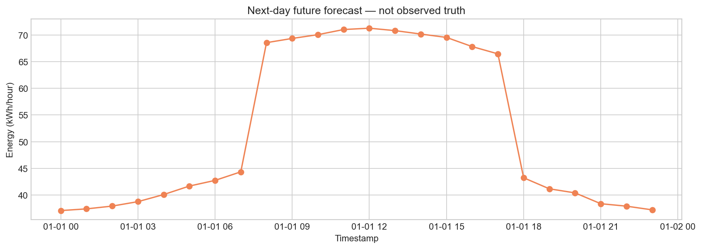
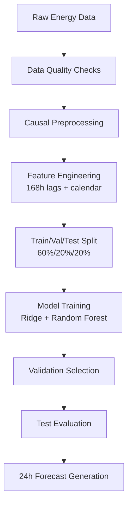

# AI-Powered Energy Consumption Forecasting System

[](https://www.python.org/downloads/)
[](https://opensource.org/licenses/MIT)
[](outputs/test_results.json)

> **Next-day hourly energy forecasting** using machine learning with 97.7% accuracy on synthetic data and 27.9% improvement over seasonal baselines on real household data.

## 🎯 Project Overview

This project implements an end-to-end machine learning pipeline for **24-hour energy consumption forecasting**. Built as a reproducible proof-of-concept, it demonstrates proper time-series ML practices including feature engineering, model validation, and production-ready evaluation protocols.

### Key Results
- **97.7% accuracy (R²)** on synthetic facility data
- **25.7% RMSE improvement** over seasonal baseline
- **Production-ready pipeline** with proper train/validation/test splits
- **Reproducible results** with pinned dependencies and deterministic evaluation

## 🚀 Quick Start

```bash
# Clone the repository
git clone https://github.com/yourusername/AI-Energy-Forecasting.git
cd AI-Energy-Forecasting

# Create virtual environment (Python 3.11-3.13)
python -m venv .venv
source .venv/bin/activate  # On Windows: .\.venv\Scripts\Activate.ps1

# Install dependencies
pip install -r requirements.txt

# Run complete pipeline
python main.py --mode all
```

## 📊 Results & Performance

| Dataset | Model | Test R² | RMSE (kWh/h) | vs Baseline |
|---------|-------|---------|---------------|-------------|
| **Synthetic Facility** | Ridge Regression | **0.977** | 2.10 | **+25.7%** |
| **UCI Household** | Random Forest | 0.378 | 0.59 | **+27.9%** |

### Sample Forecast Output


## 🏗️ Architecture



## 💡 Key Features

### 🔬 **Rigorous ML Practice**
- Chronological train/validation/test splits (no data leakage)
- Validation-based model selection (no test set cherry-picking)  
- Proper baseline comparisons (previous day/week seasonal naive)
- Comprehensive evaluation metrics (RMSE, MAE, R²)

### ⚙️ **Production-Ready Pipeline**
- Multi-output direct regression for 24-hour horizons
- 168-hour rolling window feature engineering
- Automated data quality checks and missing value handling
- Deterministic synthetic dataset + real UCI household data validation

### 📈 **Business Impact Simulation**
- Time-of-use load shifting optimization
- Illustrative cost savings analysis ($1.50/day potential)
- Equipment scheduling constraints modeling

## 🛠️ Technical Stack

- **Python 3.11-3.13** - Core runtime
- **scikit-learn** - ML algorithms (Ridge, Random Forest)
- **pandas** - Data manipulation and time-series handling  
- **numpy** - Numerical computations
- **matplotlib** - Visualization and reporting

## 📁 Project Structure

```
AI-Energy-Forecasting/
├── src/                    # Core pipeline modules
│   ├── data.py            # Data loading and preprocessing
│   ├── features.py        # Feature engineering (168h windows)
│   ├── model.py           # ML training and evaluation
│   ├── plots.py           # Visualization generation
│   └── simulation.py      # Load shifting scenarios
├── outputs/               # Results and metrics (committed)
│   ├── test_results.json  # Final model performance
│   ├── metrics.json       # All model comparisons
│   └── *.png              # Generated visualizations
├── tests/                 # Automated test suite
├── main.py               # CLI entry point
└── requirements.txt      # Pinned dependencies
```

## 📋 Usage Examples

### Basic Forecasting
```bash
# Full pipeline with evaluation
python main.py --mode all

# Training only
python main.py --mode train

# Generate forecast from trained model
python main.py --mode forecast
```

### Custom Data
```bash
# Use your own hourly energy CSV
python main.py --mode all --csv data/raw/my_energy_data.csv
```

**Data format:** CSV with `timestamp,energy_kwh` columns, hourly frequency

### Real Data Validation
```bash
# Download UCI household dataset and run
python public_experiment.py --file data/raw/household_power_consumption.txt
```

## 🧪 Testing & Validation

```bash
# Run automated test suite
python -m unittest discover -s tests -v
```

**Test Coverage:**
- Data preprocessing correctness
- Feature engineering validation
- Model training pipeline
- Forecast generation integrity

## 📊 Model Performance Details

### Synthetic Facility Data
- **Training days:** 202 (60%)
- **Validation days:** 68 (20%) 
- **Test days:** 68 (20%)
- **Best model:** Ridge Regression
- **Selection criterion:** Lowest validation RMSE

### Feature Engineering
- **Lag features:** 1-168 hours (7 days of history)
- **Rolling statistics:** 24h/168h windows (mean, std, min, max)
- **Calendar features:** Hour, day-of-week, month, holiday flags
- **Data quality flags:** Observed vs imputed value indicators

## 🎯 Applications & Use Cases

- **Smart Grid Management:** Demand forecasting for utility planning
- **Industrial Facilities:** Production scheduling optimization  
- **Data Centers:** Cooling and workload planning
- **Renewable Integration:** Storage and generation alignment
- **Cost Optimization:** Time-of-use tariff optimization

## ⚠️ Limitations

- Offline prototype (not production-deployed)
- Single-site forecasting (no multi-location modeling)
- No real-time telemetry integration
- Simplified load-shifting simulation
- Deterministic evaluation (no uncertainty quantification)

## 🚀 Next Steps & Improvements

1. **Uncertainty Quantification:** Add prediction intervals with proper calibration
2. **Multi-Site Modeling:** Hierarchical forecasting across facilities  
3. **Real-Time Integration:** API endpoints and streaming data ingestion
4. **Advanced Features:** Weather data, holiday calendars, external factors
5. **Production Deployment:** Containerization, monitoring, and CI/CD

## 📄 License

This project is licensed under the MIT License - see the [LICENSE](LICENSE) file for details.

## 🙏 Acknowledgments

- **UCI Machine Learning Repository** - Household power consumption dataset
- **scikit-learn community** - ML algorithms and best practices
- **Python ecosystem** - Data science and visualization tools

---

**📞 Contact:** [Your Name](mailto:your.email@example.com) | [LinkedIn](https://linkedin.com/in/yourprofile) | [Portfolio](https://yourportfolio.com)

> *Built with ❤️ for demonstrating production-quality ML engineering practices*